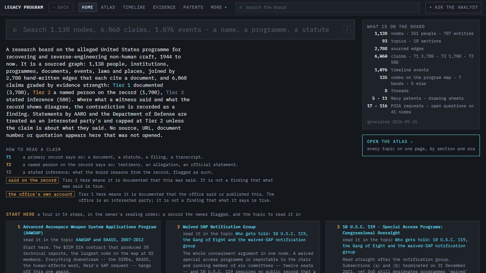
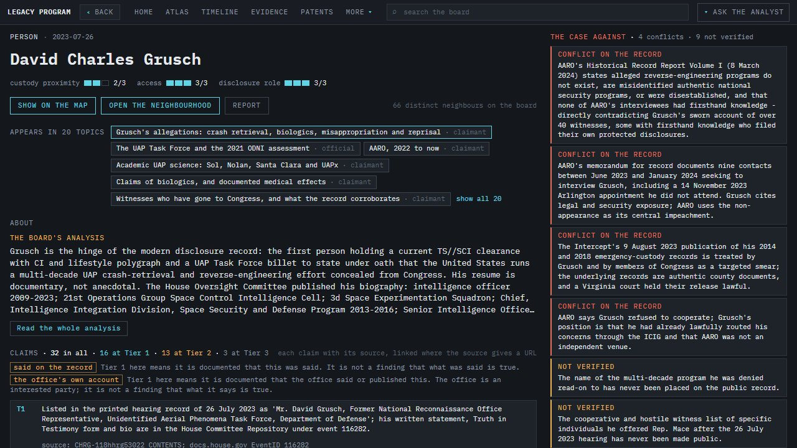
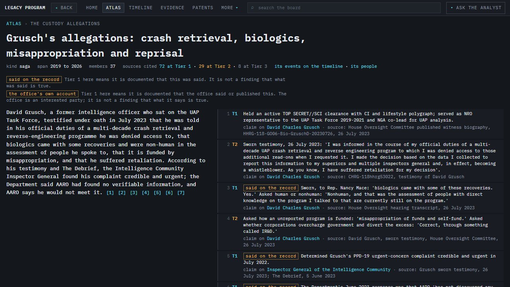
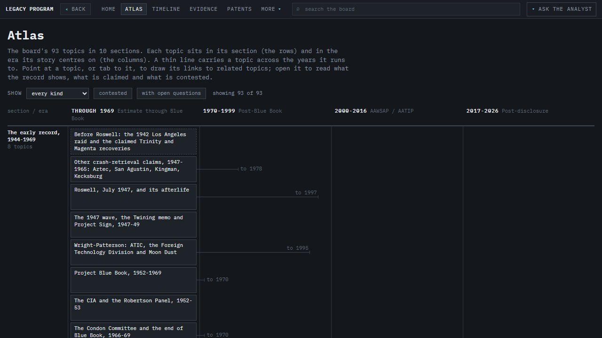
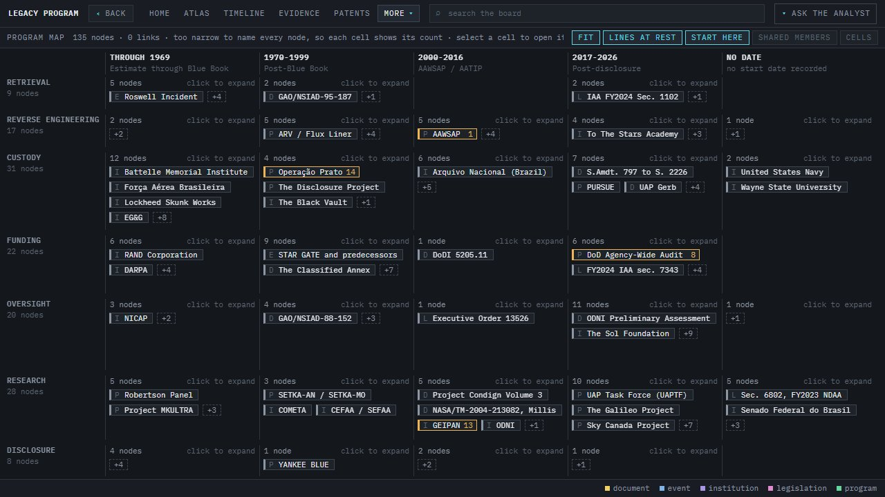

# The Legacy Program


A sourced research board on the alleged US programme to recover and reverse-engineer non-human craft, 1944 to now.



**[Open the board](https://the-program-zxz.pages.dev)** | **[Landing page](https://the-legacy-program.pages.dev)**

## What it is

A research board that maps the alleged United States programme for recovering and reverse-engineering non-human craft, from 1944 to today: the people, agencies, contractors, programmes, laws, documents, places and events that the public record and sworn testimony connect to it. It holds **1,138 nodes** (351 people, 787 institutions, programmes, documents, laws, places and events), joined by **2,788 hand-written links** that each cite a source, and **6,060 claims** each graded by how strong its evidence is, drawn from **3,992 distinct source URLs** and a **1,076-event timeline**.

It does not set out to prove the programme exists. It sets out to show, claim by claim, what a primary record establishes, what a named person has said on the record, and what is only inference, and to keep the case against each claim on the same page as the claim. You can read it by topic (93 topics in an Atlas), by person or organisation, along a timeline, through a set of big questions, or by asking for the route between any two nodes.

## How to read this

**Every link and every claim names its source.** No source, URL, document number or quotation appears on the board that was not opened and read. Where a record could not be found, the board says so in words ("no employment, service or civil record has ever been produced for this person") rather than staying silent.

**Claims are graded by evidence strength, 1 to 3. Tier 1 is strongest.**

| Tier | Means | Claims |
|---|---|---|
| **Tier 1, documented** | A primary record says so: a document, a statute, a filing, a transcript. | 3,786 |
| **Tier 2, on the record** | A named person says so: testimony, an allegation, an official statement. | 1,694 |
| **Tier 3, inference** | What the board reasons from the record, stated as reasoning and flagged as such. | 580 |

Two refinements matter:

- **"Said on the record" is not "true".** Many Tier 1 claims document that something was *said* (a sworn statement, a hearing transcript). The board marks these, because Tier 1 there means it is documented that the words were spoken, not that what was said is true.
- **Interested parties are not their own best evidence.** Statements by AARO and the Department of Defense are capped at Tier 2 unless the claim is about what they said. The same rule applies to links.

**Inclusion is not an accusation.** A person, company or agency appears because a record or a public claim connects them to the subject, not because the board finds that they did anything. Many people are here because they denied, investigated, reported on or were named by someone else. Claimants and witnesses whose accounts are widely known are included even where no record vouches for what they said; their accounts are carried at Tier 2, with how the claim reached the public, who else told it first, and the contrary record in the same node's "conflicts" and "not verified" panels.

**Node grades A, B and C are not credibility.** They measure how close a node sits to the alleged programme in the link structure. An A node carrying only Tier 3 claims is not a contradiction; it marks where the record is thinnest.

**Corrections are welcome.** If something on the board is wrong, misattributed, out of date, or names a private person who should not be here, open an issue at [github.com/Samizdat-Publications/the-legacy-program-dashboard/issues](https://github.com/Samizdat-Publications/the-legacy-program-dashboard/issues). Include the page link (each node, topic and source has its own URL), the claim as it appears, and, if you have one, the record that shows the correction. Corrections that a record supports are made and logged; a claim that is contested stays, with the contest recorded beside it.

## Screenshots

| | |
|---|---|
|  |  |
|  |  |

## How it was made

- **The app** (`app/`) is Vite 5 and TypeScript with no framework, hash-routed, reading generated JSON from `/data` at runtime. It is hosted on Cloudflare Pages and deployed by GitHub Actions after the gate passes.
- **The data pipeline** (`tools/`, Python) merges one JSON file per research pass from `research/` into the board, regrades node proximity, builds the program map, and writes the app's data. Each claim and link gets a stable id derived from its content.
- **The gate** (`tools/gate.py`) re-derives every count from source, requires the committed data to equal a fresh build, and drives the built app in a real browser through 30 checks. Every check is shown failing on a deliberately corrupted input before it is trusted.
- **The analyst** ("Ask the analyst") is a Claude-backed assistant whose tools run in the reader's browser against the board's own data, served through a separate Cloudflare Worker (`worker/`).

## Data sources

The compiled dataset (`research/`, `data/`, `app/public/data/`) cites its sources claim by claim. The board quotes short passages to show what a record says; **quoted material belongs to its authors and publishers**, and the board's citation is not a licence to reuse it. The main kinds of source:

| Source | Terms |
|---|---|
| US government records: statutes, the Congressional Record and hearing transcripts, agency reports (AARO, ODNI, DIA, GAO), FOIA releases, court filings | Works of the US federal government are in the public domain in the US |
| US patents and file wrappers (USPTO) | Public records; the eleven Navy patent drawing sheets in `app/public/patents/` are rendered from USPTO PDFs, provenance in `PROVENANCE.md` there |
| Foreign government releases (Brazil, France, Canada, the UK) | Each government's own terms; cited, linked and quoted briefly |
| Books, articles, broadcasts, podcasts and interviews | Copyright of their authors and publishers; cited and quoted briefly for commentary and research |
| WikiLeaks, The Podesta Emails | Cited by email id; personal contact details are not reproduced |

## Run it locally

Needs Python 3.13 and Node 22.

```
python tools/build.py
cd app
npm ci
npm run build
npx vite preview --host 127.0.0.1 --port 4173 --strictPort
```

Then open http://127.0.0.1:4173. `python tools/gate.py` runs every check. The analyst tries the deployed Worker and says so on screen if it cannot reach it; the rest of the board runs entirely from the local data.

## Credits

| What | Who | Licence |
|---|---|---|
| IBM Plex Mono, embedded | IBM, via Google Fonts | SIL Open Font License 1.1 (`assets/fonts/OFL.txt`) |
| Agency seals (CIA, DIA, DoD, DOE, NASA, ODNI, NARA, US House, AARO, AFOSI, NRO) | US government, via Wikimedia Commons | Public domain |
| RAND Corporation text logo | via Wikimedia Commons | Public domain (text below the threshold of originality) |

## Licence

Code is MIT (see [LICENSE](LICENSE)). The compiled dataset cites its sources; quoted material belongs to its authors, and third-party assets listed above keep their own licences.
